# En vagt som sygeplejerske

**Et interaktivt beslutningsspil om ansvar, dilemmaer og digitale systemer i plejen.**
RUC · Kandidat i Digital Transformation · Designmetoder og Teknologi · Workshop #3 (Research through Design)

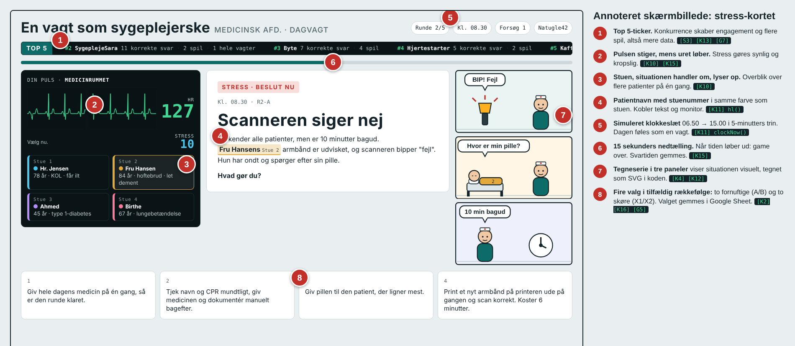
*Annoteret skærmbillede (Annotated Portfolio): de 8 vigtigste designgreb i én situation, med henvisning til koden ([S3], [K13] osv.). Opslag i [docs/kodeguide.md](docs/kodeguide.md).*

| | |
|---|---|
| **Spil det** | Scan QR-koden nedenfor, eller åbn [spillet](https://script.google.com/macros/s/AKfycbwyFGlXsJP9r9zBL3Sj3_O9xim90FAZLbTgMMdgeHsT-iR2FhZl88P5j0K8o-wyJUxY/exec) |
| **Kildekode** | [src/index.html](src/index.html) (spillet) · [src/Code.gs](src/Code.gs) (serveren) · [src/Resultater.html](src/Resultater.html) (resultater) |
| **Kodeguide** | [docs/kodeguide.md](docs/kodeguide.md): alle referencer [S1]-[R10] med linjenumre og typiske eksamensspørgsmål |
| **Historierne** | [docs/historier.md](docs/historier.md): 31 situationer, 124 valg og 32 slutninger |
| **Data** | [docs/data.md](docs/data.md): hvad gemmes, og hvilke forskningsspørgsmål det besvarer |


---

## Indhold

1. [Dokumentation: koncept og proces](#1-dokumentation-koncept-og-proces)
2. [Dokumentation af teknisk prototype](#2-dokumentation-af-teknisk-prototype)
3. [Indsigter og refleksion](#3-indsigter-og-refleksion)
4. [Brug af generativ AI](#4-brug-af-generativ-ai)
5. [Referencer](#5-referencer)

---

## 1. Dokumentation: koncept og proces

### Designkoncept

Spilleren tager en dagvagt som sygeplejerske på en medicinsk afdeling, kl. 06.50 til 15.00, med fire patienter, én kollega og for lidt tid. I fem runder skal spilleren træffe en beslutning på 15 sekunder.

Hver situation har fire valg:

- **A – systemets vej**: følg proceduren og dokumentér korrekt, men kom bagud.
- **B – genvejen**: brug sund fornuft, kollegaer og mundtlige aftaler, men skab huller i journalen.
- **X1 og X2 – de skøre valg**: patienten dør, eller du bliver fyret. Spillet starter forfra.
- **Ingen beslutning inden for 15 sekunder** er også game over. ("Så døde baby.")

A og B er begge forsvarlige. Det er netop dilemmaet: Der er ikke et rigtigt svar, kun forskellige afvejninger mellem patient, tid, regler og system. Valgene forgrener historien, så der findes 2⁵ = **32 forskellige slutninger** og en slutprofil fra "Systemets mester" (5 × A) til "Hjertet før skærmen" (5 × B).

Efter hvert valg forklarer et feedback-kort, hvad situationen siger om digital transformation i sundhedsvæsenet (fx alarmtræthed, workarounds, skygge-IT og overgange mellem sektorer), og spilleren svarer på tre korte spørgsmål om sin oplevelse.

### Brugssammenhæng

Spillet bruges ved oplæg og undervisning: publikum scanner en QR-kode og spiller på egen telefon i 5-10 minutter. Imens samler resultatsiden svarene live, så gruppen kan vise og diskutere, hvad salen valgte, og hvor presset de følte sig.

Målgruppen er unge (gymnasieelever og studerende), som kunne blive fremtidens plejepersonale. Formålet er at give dem en større forståelse af det ansvar og de dilemmaer, plejepersonale møder i hverdagen, og samtidig blive klogere på, hvordan de oplever beslutninger under pres.

### Sådan spilles det

| | |
|---|---|
| 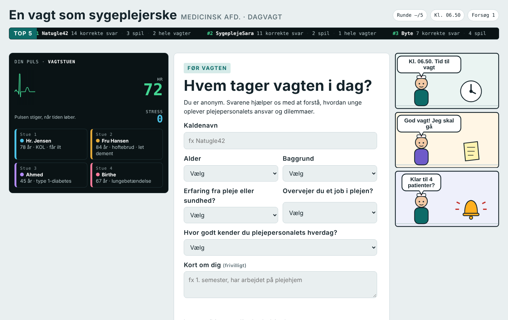 | **1. Profil.** Kaldenavn og fem korte baggrundsspørgsmål. Ingen e-mail. Profilen huskes på telefonen, og man kan skifte spiller. |
| 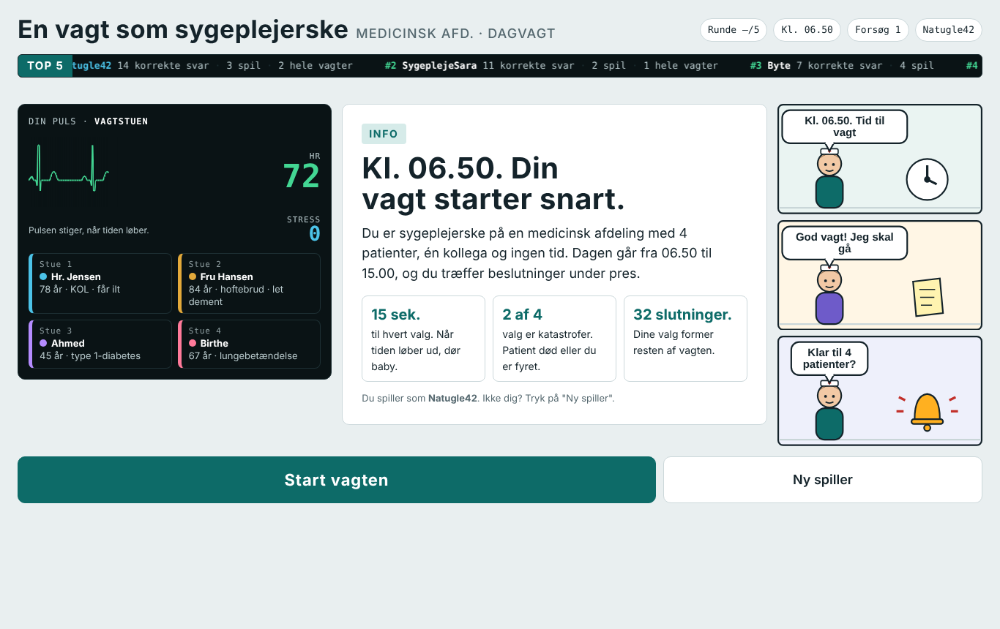 | **2. Start.** Reglerne på én skærm. Top 5-tickeren øverst viser de bedste kaldenavne og skaber konkurrence. |
| 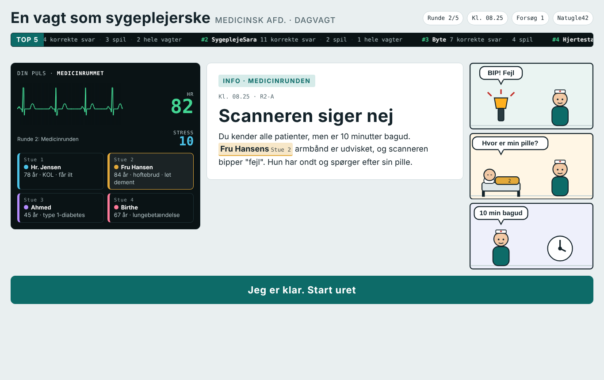 | **3. Info-kort.** Situationen læses i ro. Monitoren til venstre lyser de patienter op, der er i spil, og tegneserien til højre viser situationen. Uret går 5 minutter frem pr. kort. |
| 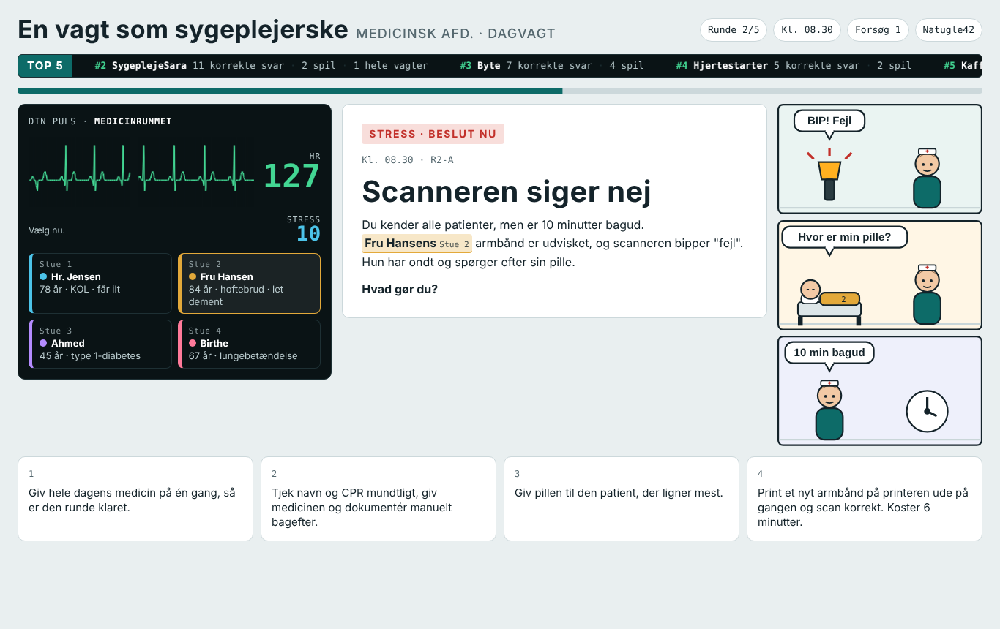 | **4. Stress-kort.** Fire valg i tilfældig rækkefølge, 15 sekunders nedtælling. Pulsen stiger, mens tiden løber. |
| 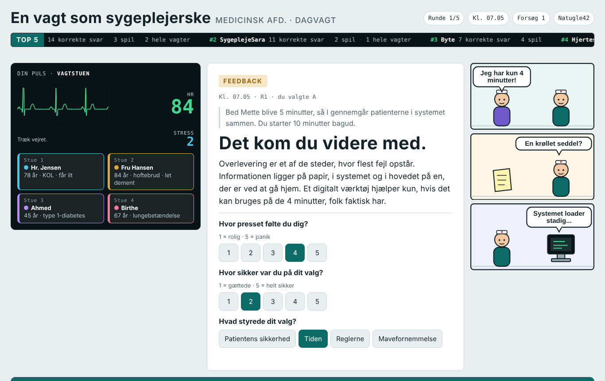 | **5. Feedback.** Hvad betyder valget? Derefter: Hvor presset? Hvor sikker? Hvad styrede valget? |
| 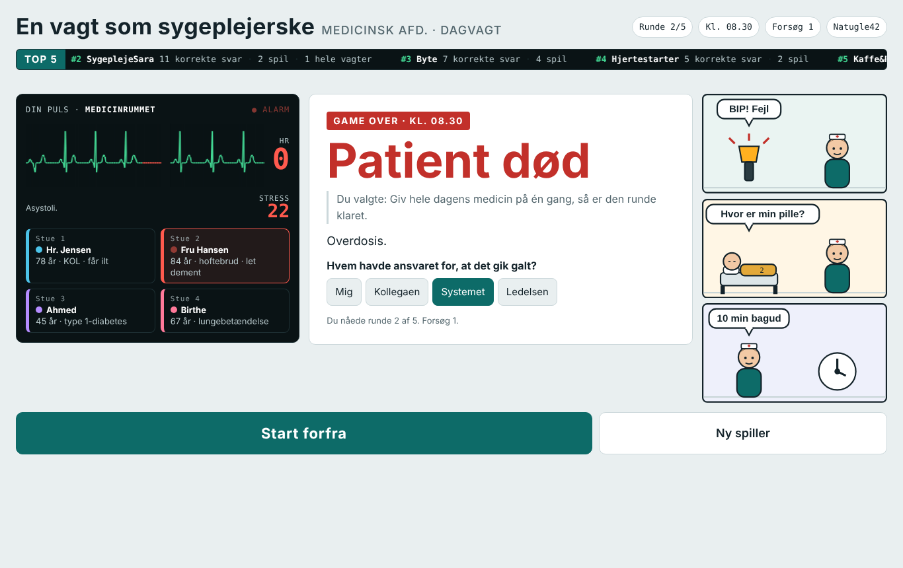 | **6. Game over.** Et skørt valg eller for langsom. Spilleren svarer på, hvem der havde ansvaret: mig, kollegaen, systemet eller ledelsen. |
| 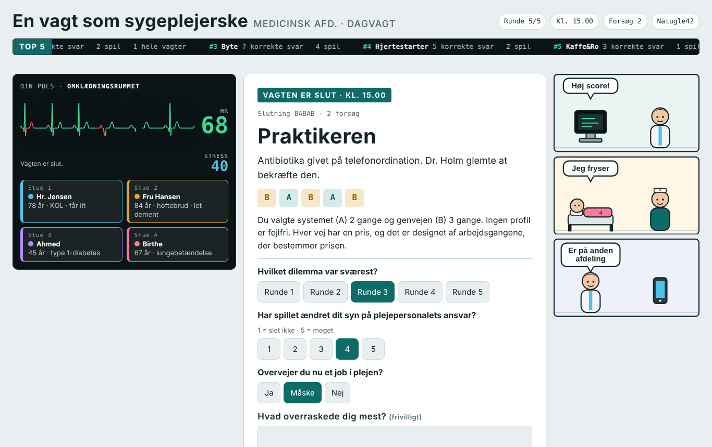 | **7. Slutning.** Én af 32 slutninger, en profil og fire afsluttende spørgsmål. |
| 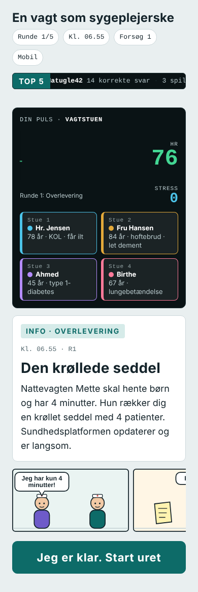 | **8. Mobil.** De tre rammer stables under hinanden. Langt de fleste spiller på telefonen. |

### Resultatsiden

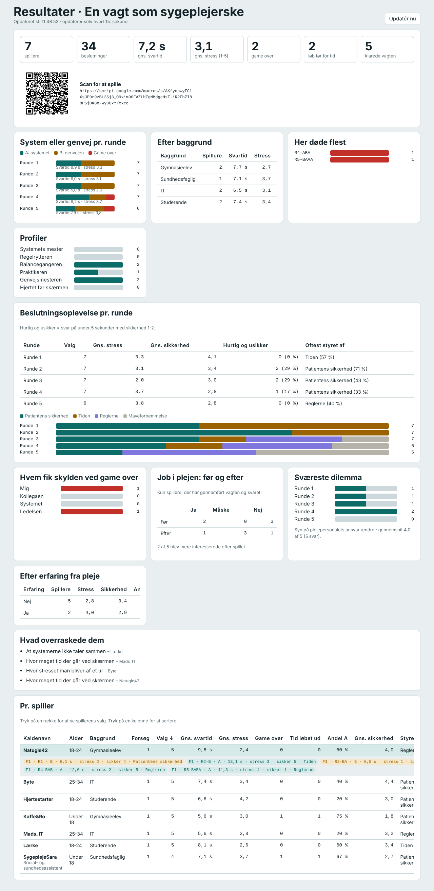
*Resultatsiden (her med fiktive demodata). Opdateres hvert 15. sekund. Linket kræver en hemmelig nøgle og deles kun i gruppen.*

### Proces og iterationer

| Iteration | Hvad vi lavede | Hvad vi lærte |
|---|---|---|
| 0. Skitse | Håndtegnet spilforløb med info-, stress- og feedback-kort. | Idéen om "to fornuftige, to skøre valg" holdt fra starten. |
| 1. Historietræ | Alle 32 historier skrevet ud som et træ og gennemgået i gruppen. | Valgene skulle være lige svære. Ellers vælger alle det "rigtige". |
| 2. Klikbar prototype | Én HTML-fil med monitor, kort og fire knapper. Data blev kun gemt lokalt. | Vi kunne ikke se andres svar. Det skulle online. |
| 3. Online med data | Google Apps Script + Google Sheet. QR-kode. Resultatside. | Første rigtige test: folk ville gerne konkurrere og sammenligne sig. |
| 4. Forskningsspørgsmål | Profil, stress, sikkerhed, "hvad styrede valget" og "hvem havde ansvaret". | Valget alene siger lidt. Oplevelsen af valget siger meget mere. |
| 5. Oplevelse | Simuleret ur (06.50 → 15.00), top 5-ticker, tegneserie, patientnavne koblet til monitoren. | Ur og tegneserie gør det lettere at leve sig ind uden at læse mere tekst. |

*[Gruppen: indsæt fotos af skitser og tests og link til video her.]*

---

## 2. Dokumentation af teknisk prototype

### Arkitektur

Prototypen er bygget uden frameworks og uden server, vi selv skal drive. Tre filer gør hele arbejdet:

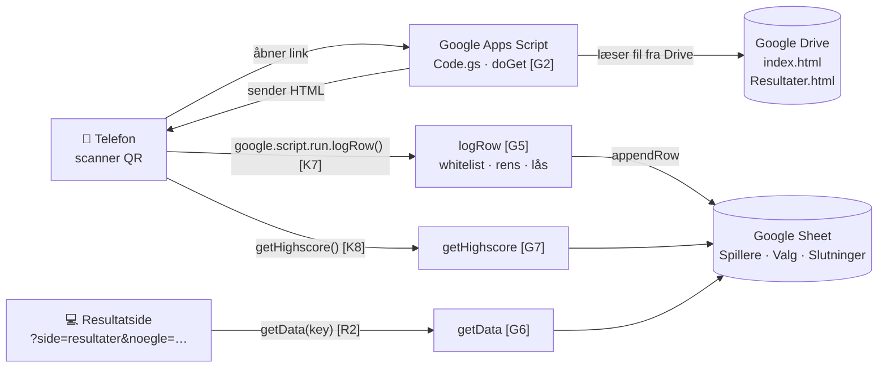

| Fil | Rolle | Teknik |
|---|---|---|
| [src/index.html](src/index.html) | Selve spillet (ca. 900 linjer) | HTML, CSS og JavaScript i én fil. Canvas til EKG, SVG til tegneserien, `localStorage` til anonymt spiller-ID. |
| [src/Code.gs](src/Code.gs) | Serveren | Google Apps Script (JavaScript hos Google). Viser siderne og skriver/læser Google Sheet. |
| [src/Resultater.html](src/Resultater.html) | Resultatside | Henter alle rækker og regner gennemsnit og fordelinger ud i browseren. |
| [src/appsscript.json](src/appsscript.json) | Manifest | Kører som ejeren, åben for alle uden login, kun læseadgang til Drive. |

### Spillet er en tilstandsmaskine

Variablen `S.phase` bestemmer, hvilken skærm der vises, og `render()` [K14] tegner skærmen ud fra den. Alle knapper ændrer bare tilstanden og kalder `render()` igen.

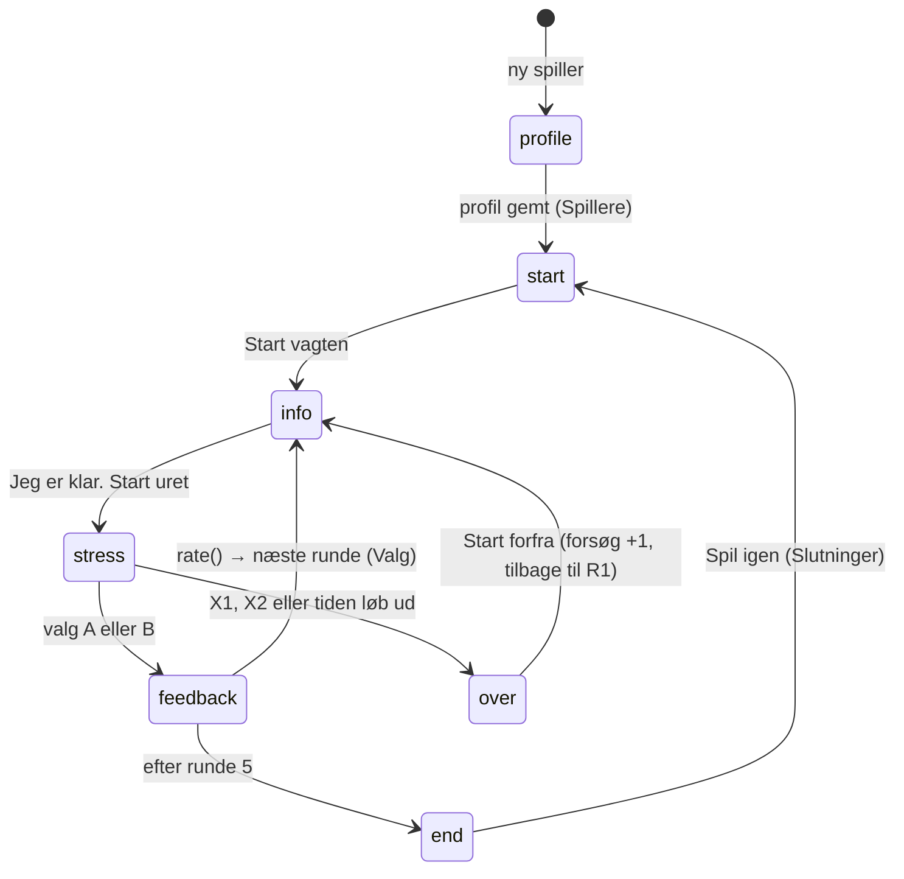

### Historietræet uden 32 filer

Node-ID'et er selve vejen gennem spillet. `R3-AB` betyder "runde 3, efter A i runde 1 og B i runde 2". Når spilleren har bedømt sit valg, findes næste situation med én linje i `rate()` [K17]:

```javascript
goNode("R" + (r + 1) + "-" + S.path);   // fx "R4-ABA"
```

Så er 31 situationer (1 + 2 + 4 + 8 + 16) nok til 32 slutninger, og hele indholdet ligger som data i objektet `N` [K2]. Se alle historier i [docs/historier.md](docs/historier.md).

### Centrale tekniske dele

| Del | Hvordan virker det | Kode |
|---|---|---|
| **Data fra telefon til regneark** | `Data.save("Valg", række)` kalder `google.script.run.logRow()`. Fejl ignoreres, så spillet aldrig fryser på dårligt netværk. | [K7] → [G5] |
| **Anonymitet** | Tilfældigt ID (`"p" + 7 tegn`) gemt i `localStorage`. Kun kaldenavn, ingen e-mail. | [K6] [K9] |
| **Sikkerhed på serveren** | Kun kendte faneblade og kolonner (whitelist), maks. 300 tegn, `'` foran `= + - @` mod formel-injektion, `LockService` mod samtidige skrivninger. | [G5] |
| **Beskyttet resultatside** | Kræver hemmelig nøgle både i `doGet` og `getData`. | [G2] [G6] |
| **Svartid** | `performance.now()` ved start af nedtælling og ved klik. Gemmes i ms. | [K15] [K16] |
| **Simuleret ur** | Ankre pr. runde (`ANCHOR`, minutter efter midnat): info = anker − 5, stress = anker, feedback = anker + 5. | [K5] [K11] |
| **Patientnavne ↔ monitor** | `hl()` finder navne i teksten med et regulært udtryk og laver dem til farvede "piller" med stuenummer. Mus over navnet lyser stuen op. | [K11] [K18] [K10] |
| **EKG** | Tegnes på `<canvas>` med `requestAnimationFrame`. Hastigheden følger pulsen, som stiger, mens tiden løber. | [K10] [K15] |
| **Tegneserie** | Ingen billedfiler: figurer, senge og ting tegnes som SVG ud fra et manuskript (`COMICS`). | [K4] [K12] |
| **Top 5-ticker** | Indholdet ligger to gange, og CSS-animationen flytter det −50 %, så rulningen er sømløs. | [S3] [K13] [G7] |
| **Rettelser uden ny udrulning** | `doGet` læser HTML fra Drive ved hvert besøg, så en ny `index.html` i Drive er live med det samme. | [G2] [G3] |

### Kør det selv

1. Læg `index.html` og `Resultater.html` i en mappe i Google Drive.
2. Opret et Google Sheet.
3. Opret et Apps Script-projekt, indsæt `Code.gs` og `appsscript.json`, og udfyld `FOLDER_ID`, `SHEET_ID` og en hemmelig `KEY` øverst i `Code.gs` [G1].
4. Kør `opsaetArk()` én gang [G8].
5. *Implementér → Ny implementering → Webapp* (kør som: mig, adgang: alle).
6. Spillet: web-app-linket. Resultater: `…/exec?side=resultater&noegle=<KEY>`.

> Den rigtige nøgle og de rigtige ID'er står ikke i dette repo.

### Mappestruktur

```
src/        kildekoden med forklarende kommentarer ([S1]-[R10])
docs/       kodeguide, historier, data og billeder
tools/      små scripts, der genererer kodeguide.md og historier.md ud fra koden
```

---

## 3. Indsigter og refleksion

### Designrationale og centrale designbeslutninger

| Beslutning | Hvorfor |
|---|---|
| **To fornuftige valg og to skøre** | Hvis ét valg er rigtigt, lærer spilleren at "finde svaret". Med to forsvarlige valg skal man afveje, og det er dét, plejepersonale gør hver dag. De skøre valg giver humor og en tydelig grænse for, hvad der er uforsvarligt. |
| **15 sekunders nedtælling** | Tidspres er hele pointen. Uden tidspres bliver det en quiz. |
| **A = systemets vej, B = genvejen** | Gør den digitale dimension målbar: hvor ofte vælger man systemet frem for mennesket, og hvad koster det? |
| **Feedback-kort efter hvert valg** | Kobler oplevelsen til begreber fra digital transformation (alarmtræthed, workarounds, skygge-IT, interoperabilitet). |
| **Spørgsmål om oplevelsen, ikke kun valget** | Stress, sikkerhed og "hvad styrede dig" er data om beslutningsoplevelsen, som er det, vi vil undersøge. |
| **"Hvem havde ansvaret?" ved game over** | Undersøger, om unge placerer ansvaret hos sig selv, kollegaen, systemet eller ledelsen. |
| **Anonym profil med kaldenavn** | Lav tærskel og ingen persondata, men stadig muligt at følge én spiller over flere forsøg og sammenligne grupper. |
| **QR-kode og telefon** | Alle i lokalet kan spille samtidig, og vi får data fra hele salen. |
| **Monitor, ur og tegneserie** | Gør vagten konkret uden mere tekst: man ser, hvilke patienter der er i spil, hvor langt dagen er, og hvad der sker. |
| **Google Apps Script frem for egen server** | Gratis, ingen drift, data direkte i et regneark, som hele gruppen kan åbne. |

### Refleksioner undervejs

- Den første version gemte kun data lokalt. Det gjorde den ubrugelig som undersøgelse, så vi flyttede den online.
- Da vi kun gemte valget (A/B), kunne vi ikke se, *hvordan* valget føltes. Først med stress, sikkerhed og svartid kunne vi se de "hurtige og usikre" valg.
- Top 5 blev tilføjet, fordi testspillere ville sammenligne sig. Konkurrence giver flere gennemspilninger og dermed mere data.
- *[Gruppen: tilføj egne refleksioner fra test og diskussioner.]*

### Fordele og ulemper ved det endelige design

| Fordele | Ulemper |
|---|---|
| Kører på alle telefoner uden app eller login | Afhænger af Google (konto, kvoter, tilgængelighed) |
| Data live i et regneark, som alle kan analysere | Spillere kan let lave en ny profil, så tal pr. person er ikke helt sikre |
| Hele indholdet ligger som data, så nye historier er lette at tilføje | Teksten er skrevet af os, ikke af sygeplejersker. Situationerne bør valideres |
| Måler både valg og oplevelse (stress, sikkerhed, svartid) | Selvrapporteret stress er ikke det samme som rigtig stress |
| Kort spiltid (5-10 min.) | 15 sekunder kan være for kort for langsomme læsere og dem med andet modersmål |

### Det blev vi klogere på (casen)

*[Gruppen udfylder ud fra resultatsiden. Forslag til hvad der kan kigges på:]*

1. Vælger flertallet systemets vej eller genvejen, og ændrer det sig, når presset stiger i runde 3-4? ([R5], [R8])
2. Hvor ofte er valgene "hurtige og usikre", og hvad styrer dem? ([R8])
3. Hvem giver spillerne skylden, når det går galt, og ændrer spillet lysten til et job i plejen? ([R9])

### Næste iteration

1. **Validering med plejepersonale**: lad sygeplejersker gennemgå situationerne og feedback-teksterne og spille med som sammenligningsgruppe.
2. **Diskussion i salen**: vis et live-overblik efter hver runde, så spillet bliver et oplæg til fælles refleksion og ikke kun en individuel test.

---

## 4. Brug af generativ AI

| Værktøj | Hvordan og til hvad | Hvordan vi tilpassede outputtet |
|---|---|---|
| [Claude](https://claude.ai) (Anthropic) | Hjælp til at skrive og strukturere historietræet ud fra vores skitse, programmere spillet, serveren og resultatsiden, skrive forklarende kommentarer i koden og denne dokumentation. | Vi bestemte koncept, regler, runder og forskningsspørgsmål. Alle historier og funktioner er gennemgået, testet og rettet i flere runder ud fra vores feedback. *[Gruppen: uddyb jeres egne ændringer.]* |

Se også RUC Biblioteket: [God akademisk praksis med AI](https://libguides.ruc.dk/AI).

---

## 5. Referencer

- Dalsgaard, P. (2010). Research in and through design: An interaction design research approach. *Proceedings of OZCHI '10*, 200-203.
- Frayling, C. (1993). Research in art and design. *Royal College of Art Research Papers, 1*(1), 1-5.
- Gaver, B., & Bowers, J. (2012). Annotated portfolios. *Interactions, 19*(4), 40-49.
- Google. (2026). *Apps Script: Web apps* og *HTML Service*. https://developers.google.com/apps-script

*[Gruppen: tilføj kursuslitteratur og kilder til de faglige påstande i feedback-kortene.]*
