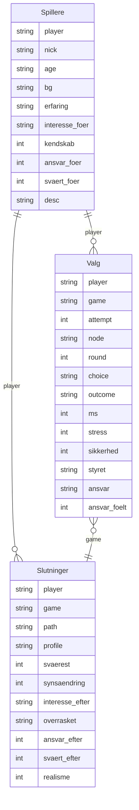

# Data: hvad gemmes, og hvorfor

Alle svar gemmes i ét Google Sheet med tre faneblade. Kolonnerne er defineret i `COLS` i [src/Code.gs](../src/Code.gs) ([G1]). Serveren afviser alt, der ikke står i `COLS` ([G5]).

Ingen e-mail, intet navn og ingen IP-adresse. En spiller er et tilfældigt ID (fx `p7k2x9a`), der ligger i telefonens `localStorage`, og et selvvalgt kaldenavn.

## Fanebladet Spillere (én række pr. profil)

| Kolonne | Eksempel | Betydning | Spørgsmål i spillet |
|---|---|---|---|
| ts | 2026-10-28T09:14:02Z | Tidspunkt | |
| player | p7k2x9a | Anonymt spiller-ID | |
| nick | Natugle42 | Kaldenavn | Kaldenavn |
| age | 18-24 | Aldersgruppe | Alder |
| bg | Studerende | Baggrund | Baggrund |
| desc | 1. semester | Fritekst, frivillig | Kort om dig |
| erfaring | Nej | Erfaring fra pleje/sundhed | Erfaring fra pleje eller sundhed? |
| interesse_foer | Måske | Job i plejen, før spillet | Overvejer du et job i plejen? |
| kendskab | 2 | 1-5 | Hvor godt kender du plejepersonalets hverdag? |
| ansvar_foer | 3 | 1-5, **før** | Hvor stort ansvar har en sygeplejerske i løbet af en vagt? |
| svaert_foer | 2 | 1-5, **før** | Hvor svært er det at træffe beslutninger som sygeplejerske? |

## Fanebladet Valg (én række pr. beslutning)

| Kolonne | Eksempel | Betydning |
|---|---|---|
| ts, player, nick | | Som ovenfor |
| game | gq3k9a | ID for én vagt (gennemspilning) |
| attempt | 2 | Forsøg nr. (stiger ved game over) |
| node | R3-AB | Situationen (se [historier.md](historier.md)) |
| round | 3 | Runde 1-5 |
| choice | B | A, B, X1, X2 eller timeout |
| outcome | videre | `videre`, `død` eller `fyret` |
| ms | 6420 | Svartid i millisekunder |
| stress | 4 | "Hvor presset følte du dig?" 1-5 |
| sikkerhed | 2 | "Hvor sikker var du på dit valg?" 1-5 |
| styret | Tiden | "Hvad styrede dit valg?" Patientens sikkerhed / Tiden / Reglerne / Mavefornemmelse |
| ansvar_foelt | 4 | "Hvor meget føltes beslutningen som dit ansvar?" 1-5 |
| ansvar | Systemet | Kun ved game over: "Hvem havde ansvaret?" Mig / Kollegaen / Systemet / Ledelsen |

## Fanebladet Slutninger (én række pr. gennemført vagt)

| Kolonne | Eksempel | Betydning |
|---|---|---|
| ts, player, nick, game, attempt | | Som ovenfor |
| path | AABBA | Hele vejen gennem de 5 runder |
| profile | Balancegangeren | Slutprofil efter antal A-valg |
| svaerest | 3 | "Hvilket dilemma var sværest?" Runde 1-5. Spilleren ser titlerne på sine egne situationer. Resultatsiden finder situationen med `path` + runde ([R13]) |
| synsaendring | 4 | "Har spillet ændret dit syn på plejepersonalets ansvar?" 1-5 |
| interesse_efter | Ja | "Overvejer du nu et job i plejen?" |
| overrasket | | "Hvad overraskede dig mest?" Fritekst, frivillig |
| ansvar_efter | 4 | Samme spørgsmål som `ansvar_foer`, **efter** vagten |
| svaert_efter | 4 | Samme spørgsmål som `svaert_foer`, **efter** vagten |
| realisme | 4 | "Hvor virkelig føltes vagten?" 1-5 |

## Fra data til indsigt (resultatsiden)

**Forskningsspørgsmål:** Hvordan kan interaktive simulationer påvirke unges oplevelse af ansvar og beslutningstagning i sygeplejefaget?

| Delspørgsmål | Måles med | Vises i |
|---|---|---|
| Ændrer spillet, hvor stort ansvaret opleves? | `ansvar_efter` − `ansvar_foer` pr. spiller | [R11] |
| Ændrer spillet, hvor svært det opleves at beslutte? | `svaert_efter` − `svaert_foer` pr. spiller | [R11] |
| Hvor meget føles beslutningerne som spillerens eget ansvar? | `ansvar_foelt` pr. runde | [R11] |
| Føltes simulationen troværdig? | `realisme` | [R11] |
| Er der forskel på alder og erfaring? | `age`, `erfaring` | [R11] [R12] |
| Hvilke dilemmaer er sværest, og hvordan føles de? | `svaerest` + `path`, `stress`, `sikkerhed`, `ansvar_foelt` pr. `node` | [R13] |
| Vælger unge systemets vej (A) eller genvejen (B)? | `choice` pr. `round` | [R5] |
| Hvor presset føles beslutningen, og hvor sikker er man? | `stress`, `sikkerhed`, `ms` | [R8] |
| Hvor mange træffer hurtige og usikre valg? | `ms` < 5000 og `sikkerhed` ≤ 2 | [R8] |
| Hvad styrer beslutninger under pres? | `styret` | [R8] |
| Hvem får skylden, når det går galt? | `ansvar` | [R9] |
| Ændrer spillet synet på plejen og lysten til jobbet? | `interesse_foer` → `interesse_efter`, `synsaendring` | [R9] |
| Er der forskel på dem med og uden erfaring? | `erfaring`, `bg` | [R6] [R9] |
| Hvor går det oftest galt? | `outcome` pr. `node` | [R7] |

## Etik og sikkerhed

- Frivilligt og anonymt. Kaldenavnet vælges af spilleren.
- Tekst kortes til 300 tegn, og formler i tekst neutraliseres ([G5]).
- Resultatsiden kræver en hemmelig nøgle i linket ([G2], [G6]). Nøglen står **ikke** i dette repo.
