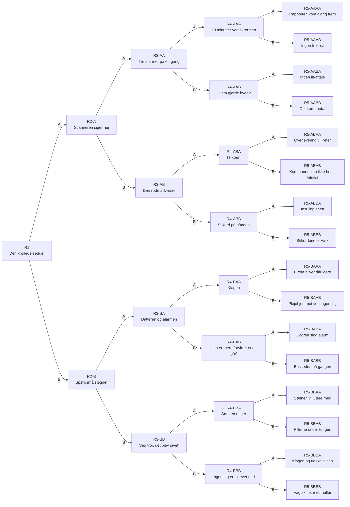

# Historietræet

Alle 31 situationer (noder) og 32 slutninger, trukket direkte ud af `N`, `ENDINGS` og `PROFILES` i [src/index.html](../src/index.html) (afsnit [K2] og [K3]). Filen er genereret, så den altid matcher koden.

**Sådan læses node-ID'et:** `R3-AB` = runde 3, efter valg **A** i runde 1 og **B** i runde 2. A og B fører videre. X1 og X2 er de "skøre" valg, der giver game over (☠️ patienten dør, 🚫 du bliver fyret).

## Patienterne

| Kode | Stue | Navn | Info |
|---|---|---|---|
| J | Stue 1 | Hr. Jensen | 78 år · KOL · får ilt |
| H | Stue 2 | Fru Hansen | 84 år · hoftebrud · let dement |
| A | Stue 3 | Ahmed | 45 år · type 1-diabetes |
| B | Stue 4 | Birthe | 67 år · lungebetændelse |

## Runderne

| Runde | Tema | Sted |
|---|---|---|
| 1 | Overlevering | Vagtstuen |
| 2 | Medicinrunden | Medicinrummet |
| 3 | Alarmer | Gangen |
| 4 | Pårørende vs. skærmen | Kontoret |
| 5 | Udskrivelse og vagtskifte | Kontoret |

## Overblik

## Runde 1 · Overlevering

### R1 · Den krøllede seddel

*Patienter:* Hr. Jensen, Fru Hansen, Ahmed, Birthe

Nattevagten Mette skal hente børn og har 4 minutter. Hun rækker dig en krøllet seddel med 4 patienter. Sundhedsplatformen opdaterer og er langsom.

| Valg | Tekst | Udfald |
|---|---|---|
| A | Bed Mette blive 5 minutter, så I gennemgår patienterne i systemet sammen. Du starter 10 minutter bagud. | → R2-A |
| B | Tag sedlen og den mundtlige overlevering, og kom i gang med det samme. | → R2-B |
| X1 | Sig "jeg kan huske det hele" og smid sedlen ud. | 🚫 Kl. 9 får Hr. Jensen Fru Hansens morfin. |
| X2 | Start dagen med en rolig kop kaffe i personalestuen. | ☠️ Ahmed fik aldrig sin insulin. |

> **Feedback:** Overlevering er et af de steder, hvor flest fejl opstår. Informationen ligger på papir, i systemet og i hovedet på en, der er ved at gå hjem. Et digitalt værktøj hjælper kun, hvis det kan bruges på de 4 minutter, folk faktisk har.

## Runde 2 · Medicinrunden

### R2-A · Scanneren siger nej

*Patienter:* Fru Hansen

Du kender alle patienter, men er 10 minutter bagud. Fru Hansens armbånd er udvisket, og scanneren bipper "fejl". Hun har ondt og spørger efter sin pille.

| Valg | Tekst | Udfald |
|---|---|---|
| A | Print et nyt armbånd på printeren ude på gangen og scan korrekt. Koster 6 minutter. | → R3-AA |
| B | Tjek navn og CPR mundtligt, giv medicinen og dokumentér manuelt bagefter. | → R3-AB |
| X1 | Giv pillen til den patient, der ligner mest. | 🚫 Hr. Jensen sover resten af dagen. |
| X2 | Giv hele dagens medicin på én gang, så er den runde klaret. | ☠️ Overdosis. |

> **Feedback:** Scanning af armbånd mindsker medicinfejl. Men når udstyret driller, opfinder personalet workarounds. Spørgsmålet er, om systemet er designet til den gode dag eller den travle.

### R2-B · Spørgsmålstegnet

*Patienter:* Fru Hansen

Du er hurtigt i gang. På sedlen står: "Fru H. smertestillende kl. 6?" Med spørgsmålstegn. Fru Hansen har ondt og kan ikke selv huske det.

| Valg | Tekst | Udfald |
|---|---|---|
| A | Log ind i medicinmodulet og tjek. Login tager 4 minutter i dag. | → R3-BA |
| B | Ring til Mette, der sidder i bilen på vej hjem. | → R3-BB |
| X1 | Giv dobbelt dosis, så er du på den sikre side. | ☠️ Hun vågner ikke igen. |
| X2 | Brug Dr. Holms login, der står åbent på computeren, og ordinér selv. | 🚫 Logningen afslører dig samme eftermiddag. |

> **Feedback:** "Er det givet eller ej?" er en klassisk usikkerhed. Når informationen kun findes på en seddel eller hos en kollega, der er gået hjem, bliver sygeplejersken detektiv i stedet for sygeplejerske.

## Runde 3 · Alarmer

### R3-AA · Tre alarmer på én gang 🚨

*Patienter:* Hr. Jensen, Ahmed, Fru Hansen

Alt er dokumenteret korrekt, men du er nu 16 minutter bagud. På én gang: Hr. Jensens iltmåler alarmerer, Ahmed trykker på klokken, og Fru Hansens sengealarm hyler.

| Valg | Tekst | Udfald |
|---|---|---|
| A | Følg alarmsystemets prioritering: ilt først. | → R4-AAA |
| B | Kald Jonas ind fra gangen og del alarmerne mellem jer. | → R4-AAB |
| X1 | Sluk alle alarmer på centralen, så der er ro til at tænke. | ☠️ Ingen opdager, at Hr. Jensens ilt falder. |
| X2 | Lad dem ringe. De plejer at være falske. | 🚫 Fru Hansen falder og brækker den anden hofte. |

> **Feedback:** Alarmtræthed er virkelig: mange alarmer er falske, så hjernen lærer at overhøre dem. Flere alarmer giver ikke mere sikkerhed, hvis de ikke er designet til at blive prioriteret.

### R3-AB · Den røde advarsel 🚨

*Patienter:* Ahmed

Din manuelle medicingivning står nu som en rød advarsel i systemet: "Medicin ikke scannet". Samtidig ringer Ahmed. Hans blodsukker er 3,1, og han sveder.

| Valg | Tekst | Udfald |
|---|---|---|
| A | Slå instruksen for lavt blodsukker op i systemet (2 minutter) og følg den trin for trin. | → R4-ABA |
| B | Giv Ahmed juice med det samme. Du kender proceduren. Dokumentér bagefter. | → R4-ABB |
| X1 | Giv Ahmed insulin. Han er jo diabetiker. | ☠️ Blodsukkeret styrtdykker. |
| X2 | Skriv først en klage over scanneren, mens irritationen er frisk. | ☠️ Ahmed besvimer, mens du skriver. |

> **Feedback:** Workarounds koster to gange: først sparer de tid, så skaber de ekstraarbejde i systemet. Det er et designproblem, ikke et dovenskabsproblem.

### R3-BA · Datteren og alarmen 🚨

*Patienter:* Birthe, Hr. Jensen

Systemet viste, at Fru Hansen fik medicin kl. 6, så du er på sporet. Nu kommer Birthes datter Susanne stormende: "Ingen har talt med min mor i dag!" Samtidig alarmerer Hr. Jensens iltmåler.

| Valg | Tekst | Udfald |
|---|---|---|
| A | Bed Susanne vente 5 minutter og gå til alarmen. | → R4-BAA |
| B | Tag Susanne med hen til Hr. Jensens stue og tal med hende, mens du arbejder. | → R4-BAB |
| X1 | Bed Susanne kigge til Hr. Jensen. Hun virker kompetent. | ☠️ Hun er revisor. |
| X2 | Skru Hr. Jensens ilt helt op og gå i kantinen. | ☠️ KOL-patienter kan ikke tåle for meget ilt. |

> **Feedback:** Alarmer konkurrerer med mennesker. Intet system prioriterer en bekymret pårørende, men hun er en del af arbejdet.

### R3-BB · "Jeg tror, det blev givet" 🚨

*Patienter:* Fru Hansen, Ahmed

Mette sagde i telefonen: "Jeg tror, det blev givet." Så du ventede. Nu er Fru Hansen urolig og har ondt, hendes sengealarm går, og Ahmed trykker på klokken.

| Valg | Tekst | Udfald |
|---|---|---|
| A | Ring til Dr. Holm og få en ny smerteordination lagt ind i systemet. | → R4-BBA |
| B | Sæt dig 2 minutter hos Fru Hansen og berolig hende. Ahmed må vente lidt. | → R4-BBB |
| X1 | Bind Fru Hansen fast i sengen med et lagen. | 🚫 Det er tvang uden lovhjemmel. |
| X2 | Giv Fru Hansen en af Ahmeds sovepiller. | ☠️ Forkert patient, forkert medicin. |

> **Feedback:** Usikker information om morgenen forplanter sig gennem hele dagen. Et "jeg tror" kl. 8 bliver til en urolig patient kl. 10.

## Runde 4 · Pårørende vs. skærmen

### R4-AAA · 20 minutter ved skærmen

*Patienter:* Birthe, Hr. Jensen

Hr. Jensen er stabil. Du er nu 25 minutter bagud med dokumentationen. Susanne står i døren og vil tale om sin mor.

| Valg | Tekst | Udfald |
|---|---|---|
| A | Dokumentér først (20 minutter), tal med Susanne bagefter. | → R5-AAAA |
| B | Tal med Susanne nu. Dokumentér i din frokostpause. | → R5-AAAB |
| X1 | Lad Susanne skrive i journalen selv. Hun kender sin mor bedst. | 🚫 Brud på journalpligten. |
| X2 | Kopiér gårsdagens notater ind for alle patienter og tryk gem. | ☠️ Aftenvagten handler på forkerte oplysninger. |

> **Feedback:** Sygeplejersker bruger en stor del af vagten ved skærmen. Hver time ved computeren er en time væk fra patienterne.

### R4-AAB · Hvem gjorde hvad?

*Patienter:* Hr. Jensen

Jonas tog to af alarmerne. Nu skal begge dele dokumenteres, men ingen af jer ved helt, hvem der gjorde hvad hvornår. Susanne venter på gangen.

| Valg | Tekst | Udfald |
|---|---|---|
| A | Sæt dig med Jonas i 10 minutter og dokumentér det præcist sammen. | → R5-AABA |
| B | Skriv selv et kort samlet notat og sig til Susanne, at du kommer om lidt. | → R5-AABB |
| X1 | Skriv, at Jonas gjorde det hele. Så er det hans problem. | 🚫 Jonas læser det. |
| X2 | Gå til frokost med Jonas. Nattevagten kan dokumentere. | ☠️ Ingen ved, hvad Hr. Jensen fik. |

> **Feedback:** Samarbejde redder travle situationer, men systemerne er bygget til én bruger ad gangen. Teamwork bliver usynligt i journalen.

### R4-ABA · IT-køen

*Patienter:* Ahmed, Birthe

Ahmed er stabil efter instruksen. Men den røde advarsel fra i morges står der stadig, og du skal dokumentere både den og det lave blodsukker. Susanne kommer med en klage.

| Valg | Tekst | Udfald |
|---|---|---|
| A | Ring til IT-support, så advarslen bliver rettet korrekt. 15 minutter i telefonkø. | → R5-ABAA |
| B | Skriv et fritekst-notat, der forklarer det hele, og gå til Susanne. | → R5-ABAB |
| X1 | Slet Fru Hansens medicinordination. Så forsvinder advarslen. | ☠️ Hun får ingen medicin resten af ugen. |
| X2 | Fortæl Susanne, at hendes mor er død, så du får fred. | 🚫 Det er hun ikke. |

> **Feedback:** Når hverdagsfejl kræver IT-support, stjæler systemet tid fra plejen. Fritekst er sygeplejerskens nødudgang.

### R4-ABB · Stikord på hånden

*Patienter:* Ahmed, Birthe

Ahmed fik juice og har det fint. Men nu mangler tre ting at blive dokumenteret. Ahmeds kone spørger, hvornår han kommer hjem, og Susanne venter.

| Valg | Tekst | Udfald |
|---|---|---|
| A | Dokumentér de tre ting nu, mens du kan huske dem. | → R5-ABBA |
| B | Tal med de pårørende først. Skriv stikord på hånden. | → R5-ABBB |
| X1 | Lov Ahmeds kone, at han kommer hjem i dag, selvom lægen ikke har set ham. | 🚫 Lægen siger nej. Konen klager. |
| X2 | Skriv det hele i en privat Messenger-gruppe med kollegerne i stedet for i journalen. | 🚫 Datalæk. |

> **Feedback:** Sedler, stikord på hånden og private apps opstår, når de officielle systemer er for langsomme. Det hedder skygge-IT, og det er et sikkerhedsproblem.

### R4-BAA · Klagen

*Patienter:* Birthe

Susanne har klaget til afdelingssygeplejersken over ventetiden. Du skal nu både tale med hende og dokumentere samtalen og Birthes tilstand.

| Valg | Tekst | Udfald |
|---|---|---|
| A | Skriv et formelt notat om sagen i systemet, før du taler med hende igen. | → R5-BAAA |
| B | Gå direkte ind til Birthe og Susanne og tag samtalen ordentligt nu. | → R5-BAAB |
| X1 | Gem dig i linnedrummet, til Susanne er gået. | 🚫 Afdelingssygeplejersken finder dig. |
| X2 | Giv Susanne dit login, så hun selv kan følge med i journalen. | 🚫 Brud på tavshedspligten. |

> **Feedback:** Pårørende er ofte dem, der opdager forværring først. Når de må vente, bliver de til et problem i stedet for en ressource.

### R4-BAB · "Hun er mere forvirret end i går"

*Patienter:* Birthe

Du talte med Susanne, mens du arbejdede. Hun siger, at Birthe er mere forvirret end i går. Det er vigtig information, men den står ingen steder.

| Valg | Tekst | Udfald |
|---|---|---|
| A | Mål Birthes værdier og registrér en tidlig opsporings-score i systemet. | → R5-BABA |
| B | Sig det mundtligt til Dr. Holm, når du møder ham på gangen. | → R5-BABB |
| X1 | Sig til Susanne, at hun forestiller sig ting. | ☠️ Birthe har blodforgiftning. |
| X2 | Giv Birthe en kop stærk kaffe. Det hjælper altid på forvirring. | ☠️ Det gør det ikke. |

> **Feedback:** Pårørendes observationer har ingen fast plads i systemet. Den vigtigste information kommer ofte fra en datter på gangen.

### R4-BBA · Sønnen ringer

*Patienter:* Fru Hansen

Dr. Holm har lagt en ny ordination ind, og Fru Hansen har det bedre. Nu ringer hendes søn og vil have status. Du har ikke dokumenteret noget siden kl. 8.

| Valg | Tekst | Udfald |
|---|---|---|
| A | Bed sønnen ringe igen om en time, og dokumentér formiddagen først. | → R5-BBAA |
| B | Tag samtalen nu. Han kender sin mors vaner og kan hjælpe. | → R5-BBAB |
| X1 | Fortæl sønnen, at hun er udskrevet, så han kommer og henter hende. | 🚫 Han kommer. Hun er ikke udskrevet. |
| X2 | Giv ham Dr. Holms private mobilnummer. | 🚫 Dr. Holm er ikke begejstret. |

> **Feedback:** Telefonsamtaler med pårørende er en stor og usynlig del af arbejdet. De bliver sjældent registreret, men de tager tid.

### R4-BBB · Ingenting er skrevet ned

*Patienter:* Ahmed

Du sad hos Fru Hansen, og Ahmed ventede. Han er sur og har skrevet en klage. Du har ikke dokumenteret noget siden kl. 7.

| Valg | Tekst | Udfald |
|---|---|---|
| A | Sæt 30 minutter af og indhent al dokumentationen. | → R5-BBBA |
| B | Gå til Ahmed og undskyld. Dokumentér i små bidder resten af dagen. | → R5-BBBB |
| X1 | Skriv "alt normalt" ved alle patienter. | ☠️ Birthe var ikke normal. |
| X2 | Sig op på stedet og gå hjem. | 🚫 Du er (selv)fyret. |

> **Feedback:** Omsorg tager tid, som intet system måler. Det, der ikke står i journalen, er officielt ikke sket.

## Runde 5 · Udskrivelse og vagtskifte

### R5-AAAA · Rapporten kom aldrig frem

*Patienter:* Hr. Jensen

Alt er dokumenteret. Hr. Jensen skal hjem kl. 15, men kommunen har ikke modtaget udskrivningsrapporten. Integrationen mellem systemerne har fejlet.

| Valg | Tekst | Udfald |
|---|---|---|
| A | Send rapporten igen gennem systemet og vent på kvittering. | → slutning |
| B | Ring direkte til hjemmeplejen og forklar det mundtligt. | → slutning |
| X1 | Send ham hjem i taxa med iltflasken på skødet og en post-it. | ☠️ Iltflasken løber tør i nat. |
| X2 | Kør ham selv hjem i din egen bil. | 🚫 Afdelingen er ubemandet i en time. |

> **Feedback:** Overgangen mellem hospital og kommune er et af de største huller i sundhedsvæsenet. Systemerne taler ikke altid sammen.

### R5-AAAB · Ingen frokost

*Patienter:* Hr. Jensen

Du sprang frokosten over. Du er træt og sulten, og Hr. Jensens medicinliste skal afstemmes mellem to systemer før udskrivelsen.

| Valg | Tekst | Udfald |
|---|---|---|
| A | Afstem medicinlisten linje for linje. | → slutning |
| B | Bed Jonas dobbelttjekke, mens du spiser en bolle. | → slutning |
| X1 | Spis Hr. Jensens frokost og gå videre. | 🚫 Han klager. Med rette. |
| X2 | Brug medicinlisten fra hans sidste indlæggelse. | ☠️ Den er fra 2019. |

> **Feedback:** Pauser er en sikkerhedsfaktor. Træthed og sult øger fejl, men ingen systemer planlægger pausen ind.

### R5-AABA · Ingen ilt-aftale

*Patienter:* Hr. Jensen

Hr. Jensen er klar til udskrivelse. Kommunen ringer: "Vi har ingen aftale om ilt i hjemmet."

| Valg | Tekst | Udfald |
|---|---|---|
| A | Udfyld kommunens hjælpemiddelblanket i systemet. Den har 3 skærmbilleder. | → slutning |
| B | Udsæt udskrivelsen til i morgen og giv Dr. Holm besked. | → slutning |
| X1 | Lov at sende en iltflaske med posten. | ☠️ PostNord leverer om 3-5 hverdage. |
| X2 | Sig, at det er kommunens problem, og læg på. | ☠️ Hr. Jensen kommer hjem uden ilt. |

> **Feedback:** Udskrivelser fejler oftest på overgangen mellem sektorer. Hver part har sit eget system og sin egen blanket.

### R5-AABB · Det korte notat

*Patienter:* Hr. Jensen

Kommunen har læst dit korte notat og forstår ikke, hvad Jonas gjorde. De ringer midt i vagtskiftet.

| Valg | Tekst | Udfald |
|---|---|---|
| A | Ret notatet i systemet, så det er komplet. | → slutning |
| B | Forklar det i telefonen og bed dem skrive det ned. | → slutning |
| X1 | Ræk telefonen til Fru Hansen. | 🚫 Hun bestiller en pizza. |
| X2 | Sig, at Hr. Jensen sagtens klarer sig uden hjemmepleje. | ☠️ Det gør han ikke. |

> **Feedback:** Korte notater sparer tid nu og koster tid senere, for en anden.

### R5-ABAA · Overlevering til Peter

*Patienter:* Hr. Jensen

IT fik rettet advarslen, men det kostede 15 minutter. Kl. 15 kommer aftenvagten Peter, og Hr. Jensen skal udskrives.

| Valg | Tekst | Udfald |
|---|---|---|
| A | Lav en struktureret overlevering til Peter i systemet. | → slutning |
| B | Giv Peter en hurtig mundtlig overlevering og en seddel. | → slutning |
| X1 | Sig "det står i systemet" og gå. | ☠️ Det gjorde det ikke. |
| X2 | Tag Peters vagt også. Du har jo styr på det. | ☠️ Kl. 22 forveksler du to patienter. |

> **Feedback:** Dagen slutter, som den startede: med en overlevering. Uden et bedre design gentager problemet sig hver 8. time.

### R5-ABAB · Kommunen kan ikke læse fritekst

*Patienter:* Hr. Jensen

Dit fritekst-notat blev sendt med udskrivelsen. Kommunens system kan kun læse de strukturerede felter, så de ringer og spørger.

| Valg | Tekst | Udfald |
|---|---|---|
| A | Udfyld de strukturerede felter i systemet. | → slutning |
| B | Send notatet som PDF med sikker mail. | → slutning |
| X1 | Send det fra din private Gmail. | 🚫 Datatilsynet ringer. |
| X2 | Fax det til det første nummer, du finder. | 🚫 Det var en pizzeria. |

> **Feedback:** Fritekst kan læses af mennesker, men ikke af systemer. Data skal være struktureret, hvis den skal kunne flyde mellem organisationer.

### R5-ABBA · Insulinplanen

*Patienter:* Ahmed

Ahmed skal hjem, og hans nye insulinplan skal sendes til hans egen læge. Hans kone er stadig utilfreds.

| Valg | Tekst | Udfald |
|---|---|---|
| A | Send planen elektronisk til egen læge og vent på kvittering. | → slutning |
| B | Print planen og giv den til Ahmed i hånden. | → slutning |
| X1 | Sig til Ahmed, at han bare kan gætte doserne. | ☠️ Han gætter forkert. |
| X2 | Skriv planen på en serviet. | ☠️ Den bliver vasket med bukserne. |

> **Feedback:** Patienten ender ofte som budbringer mellem systemer, der ikke taler sammen.

### R5-ABBB · Stikordene er væk

*Patienter:* Ahmed

Du vaskede hænder, som du skal. Stikordene på hånden er væk, og Ahmed skal udskrives.

| Valg | Tekst | Udfald |
|---|---|---|
| A | Genskab forløbet ud fra systemets data: målinger og medicinlog. | → slutning |
| B | Spørg Jonas og Ahmed, hvad der skete. | → slutning |
| X1 | Find på noget, der lyder rigtigt. | 🚫 Det lød rigtigt. Det var det ikke. |
| X2 | Lad være med at vaske hænder resten af dagen. | ☠️ Infektion. |

> **Feedback:** Håndhygiejne og noter på hånden er i direkte konflikt. Når det rigtige og det praktiske strækker i hver sin retning, er det designet, der fejler.

### R5-BAAA · Birthe bliver dårligere 🚨

*Patienter:* Birthe

Notatet om Susannes klage er skrevet. Kl. 14.30 bliver Birthe pludselig dårligere. Dr. Holm er til møde.

| Valg | Tekst | Udfald |
|---|---|---|
| A | Tilkald akutteamet via systemets procedure. | → slutning |
| B | Løb op og hent Dr. Holm fra mødet. | → slutning |
| X1 | Google Birthes symptomer. | ☠️ Google siger forkølelse. |
| X2 | Vent til aftenvagten kommer. | ☠️ Den når hun ikke. |

> **Feedback:** Faste procedurer for akut forværring redder liv, fordi de virker, også når man er træt og presset.

### R5-BAAB · Plejehjemmet ved ingenting

*Patienter:* Birthe

Susanne fortæller, at Birthe skal på plejehjem i morgen. Plejehjemmet har intet hørt.

| Valg | Tekst | Udfald |
|---|---|---|
| A | Send en plejeforløbsplan elektronisk til plejehjemmet. | → slutning |
| B | Ring til plejehjemmet og aftal det direkte. | → slutning |
| X1 | Bed Susanne køre sin mor derhen i dag. | ☠️ Ingen tager imod dem. |
| X2 | Lov at Birthe kan blive på hospitalet resten af livet. | 🚫 Det kan hun ikke. |

> **Feedback:** Pårørende ved ofte mere om planen end systemet gør. De er limen mellem sektorerne.

### R5-BABA · Scoren slog alarm 🚨

*Patienter:* Birthe

Den score, du registrerede, var høj. Systemet har advaret Dr. Holm. Birthe skal have antibiotika nu, men Holm er på en anden afdeling.

| Valg | Tekst | Udfald |
|---|---|---|
| A | Bed Holm logge på eksternt og ordinere i systemet. | → slutning |
| B | Tag en telefonordination, skriv den ned og få den bekræftet bagefter. | → slutning |
| X1 | Tag antibiotika fra Ahmeds skuffe. | ☠️ Hun er allergisk. |
| X2 | Vent til i morgen. | ☠️ Blodforgiftning venter ikke. |

> **Feedback:** Her virkede teknologien: systemet fangede faren tidligt. Digitalisering er stærkest, når den understøtter et klinisk skøn.

### R5-BABB · Beskeden på gangen 🚨

*Patienter:* Birthe

Du sagde det til Dr. Holm på gangen, men han har glemt det. Kl. 14.30 er Birthe tydeligt dårligere.

| Valg | Tekst | Udfald |
|---|---|---|
| A | Registrér scoren nu og eskalér via systemet. | → slutning |
| B | Find Dr. Holm igen og insistér. | → slutning |
| X1 | Skriv en post-it til Holm og sæt den på kaffemaskinen. | ☠️ Han drikker te. |
| X2 | Giv Birthe ilt fra Hr. Jensens flaske og håb det bedste. | ☠️ Håb er ikke en behandling. |

> **Feedback:** Mundtlige beskeder på gangen forsvinder. Det, der ikke er registreret, kan ikke følges op.

### R5-BBAA · Sønnen vil være med

*Patienter:* Fru Hansen

Formiddagen er dokumenteret. Sønnen ringer igen, irriteret. Fru Hansen skal hjem i morgen med hjemmepleje, og han vil være med i planlægningen.

| Valg | Tekst | Udfald |
|---|---|---|
| A | Inviter ham til et videomøde i morgen via regionens app. | → slutning |
| B | Lav aftalen med ham i telefonen nu og skriv den ind. | → slutning |
| X1 | Giv ham dit private nummer og sig "bare skriv". | 🚫 Han skriver. Kl. 2 om natten. |
| X2 | Send Fru Hansen hjem i taxa i aften i stedet. | ☠️ Ingen er hjemme. |

> **Feedback:** Digitale møder kan inddrage pårørende, men kun hvis de kan finde ud af appen. Digital inklusion er også design.

### R5-BBAB · Pillerne under tungen

*Patienter:* Fru Hansen

Sønnen fortæller, at hans mor gemmer piller under tungen og spytter dem ud. Det er vigtigt. Men hvor skal det stå?

| Valg | Tekst | Udfald |
|---|---|---|
| A | Skriv det i et fast felt i journalen, så alle kan se det. | → slutning |
| B | Fortæl det til Peter ved overleveringen. | → slutning |
| X1 | Ignorer det. Pårørende overdriver altid. | ☠️ Hun har ikke fået medicin i en uge. |
| X2 | Knus alle hendes piller i kaffen uden at spørge lægen. | 🚫 Skjult medicinering kræver lægeordination. |

> **Feedback:** Pårørendes viden har sjældent en fast plads i systemet. Så lever den kun, så længe nogen husker den.

### R5-BBBA · Klagen og udskrivelsen

*Patienter:* Ahmed

Du har indhentet dokumentationen. Ahmed skal udskrives, og hans klage ligger stadig ubesvaret.

| Valg | Tekst | Udfald |
|---|---|---|
| A | Besvar klagen i systemets klagemodul og udskriv Ahmed korrekt. | → slutning |
| B | Tal med Ahmed ansigt til ansigt, før han går. | → slutning |
| X1 | Slet klagen. | 🚫 Den var allerede journaliseret. |
| X2 | Udskriv Ahmed uden insulin, så du bliver færdig. | ☠️ Han er tilbage i nat. I ambulance. |

> **Feedback:** Et klagemodul registrerer utilfredshed, men det er samtalen, der genopbygger tilliden.

### R5-BBBB · Vagtskiftet med huller

*Patienter:* Hr. Jensen, Fru Hansen, Ahmed, Birthe

Klokken er 14.55. Du har dokumenteret i bidder, men meget mangler. Peter står klar.

| Valg | Tekst | Udfald |
|---|---|---|
| A | Bliv 30 minutter over og skriv det hele færdigt. Ubetalt. | → slutning |
| B | Giv Peter en grundig mundtlig overlevering og gå til tiden. | → slutning |
| X1 | Gå hjem uden at sige noget. | ☠️ Peter ved intet. |
| X2 | Sig til Peter, at han kan gætte sig frem. | ☠️ Han gætter forkert. |

> **Feedback:** Mange sygeplejersker bliver ubetalt over for at nå dokumentationen. Det er usynligt arbejde, som systemet forudsætter.

## De 32 slutninger

Profilen afhænger af antal A-valg (systemets vej): 5 A = Systemets mester · 4 A = Regelrytteren · 3 A = Balancegangeren · 2 A = Praktikeren · 1 A = Genvejsmesteren · 0 A = Hjertet før skærmen.

| Vej | Profil | Slutning |
|---|---|---|
| AAAAA | Systemets mester | Kvitteringen kom kl. 15.40. Hr. Jensen kom sikkert hjem, og du gik 40 minutter over tid. |
| AAAAB | Regelrytteren | Hjemmeplejen fik besked i telefonen. Journalen er perfekt, bortset fra den sidste samtale. |
| AAABA | Regelrytteren | Medicinlisten er afstemt. Du var tæt på at besvime i omklædningsrummet. |
| AAABB | Balancegangeren | Jonas fangede en fejl i medicinlisten, mens du spiste. Teamwork virker. |
| AABAA | Regelrytteren | Iltaftalen kom på plads kl. 16.10. Hr. Jensen ventede 70 minutter i jakke. |
| AABAB | Balancegangeren | Hr. Jensen blev en nat mere. Sikkert, men akutmodtagelsen mangler en seng. |
| AABBA | Balancegangeren | Notatet er nu komplet, og kommunen er glad. Du gik 20 minutter for sent. |
| AABBB | Praktikeren | Kommunen skrev det ned på en blok. Ingen ved, om det når frem til hjemmehjælperen. |
| ABAAA | Regelrytteren | Peter fik en perfekt overlevering i systemet. Han havde bare ikke tid til at læse den. |
| ABAAB | Balancegangeren | Peter fik det vigtigste mundtligt. Sedlen fandt han i lommen næste morgen. |
| ABABA | Balancegangeren | De strukturerede felter er udfyldt. Nu kan kommunen læse det, du skrev i morges. |
| ABABB | Praktikeren | PDF'en kom frem. Kommunen tastede det hele ind igen i hånden. |
| ABBAA | Balancegangeren | Egen læge fik insulinplanen. Ahmed fik den aldrig forklaret. |
| ABBAB | Praktikeren | Ahmed gik hjem med planen i hånden. Egen læge har intet set. |
| ABBBA | Praktikeren | Systemets data reddede dig. Det, du huskede, passede ikke helt. |
| ABBBB | Genvejsmesteren | Jonas og Ahmed huskede hver sin version. Journalen fik en tredje. |
| BAAAA | Regelrytteren | Akutteamet kom på 3 minutter. Birthe overlevede, fordi proceduren virkede. |
| BAAAB | Balancegangeren | Dr. Holm kom løbende fra mødet. Birthe blev stabiliseret. |
| BAABA | Balancegangeren | Plejeforløbsplanen er sendt. Plejehjemmet åbner den i morgen kl. 9. |
| BAABB | Praktikeren | Plejehjemmet er klar. Ingen i systemet ved, at aftalen er lavet. |
| BABAA | Balancegangeren | Antibiotika givet kl. 14.52. Systemet fangede det, Susanne så. |
| BABAB | Praktikeren | Antibiotika givet på telefonordination. Dr. Holm glemte at bekræfte den. |
| BABBA | Praktikeren | Scoren eskalerede sagen. Birthe fik hjælp 2 timer senere, end hun kunne have fået. |
| BABBB | Genvejsmesteren | Dr. Holm kom. Næste gang er det måske ikke dig, der finder ham. |
| BBAAA | Balancegangeren | Videomødet er booket. Sønnen har bare aldrig brugt appen. |
| BBAAB | Praktikeren | Aftalen er på plads, og sønnen føler sig hørt. |
| BBABA | Praktikeren | Advarslen om pillerne står nu i journalen. Aftenvagten så den. |
| BBABB | Genvejsmesteren | Peter fik beskeden om pillerne. Nattevagten fik den ikke. |
| BBBAA | Praktikeren | Klagen er besvaret i modulet. Ahmed kommer ikke tilbage, hvis han kan undgå det. |
| BBBAB | Genvejsmesteren | Ahmed trak klagen tilbage efter jeres samtale. |
| BBBBA | Genvejsmesteren | Du gik hjem kl. 15.30, ubetalt. Men alt står i journalen. |
| BBBBB | Hjertet før skærmen | Peter ved alt. Journalen ved næsten intet. Går noget galt i nat, står du alene. |
