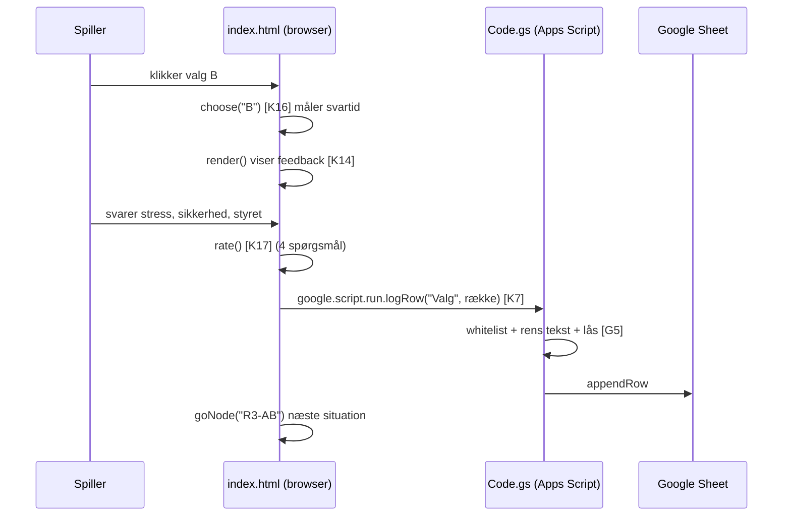

# Kodeguide

Opslag fra dokumentationen til koden. Hvert afsnit i koden starter med en kommentar som `/* [K14] ... */`.
Klik på referencen for at hoppe direkte til linjen på GitHub, eller søg efter fx `[K14]` i filen.

> Filen er genereret af `tools/lav-kodeguide.py`, så linjenumrene altid passer.

**Bogstaverne betyder:** S = stil (CSS) · H = HTML · K = klient-JavaScript · G = Google Apps Script (server) · R = resultatsiden

## src/index.html – spillet

| Ref | Del | Navne i koden | Hvad sker der |
|---|---|---|---|
| [S1](../src/index.html#L28) | **Design-tokens og tema** (linje 28) | `:root`, `--mon-*` | Alle farver ligger som CSS-variabler ét sted. Resten af CSS'en bruger kun variablerne, så tema og lys/mørk tilstand styres centralt. |
| [S2](../src/index.html#L57) | **Topbjælke** (linje 57) | `.top`, `.chip` | Titel og små "chips" med runde, klokkeslæt, forsøg og spiller. |
| [S3](../src/index.html#L67) | **Tidslinje** (linje 67) | `.timeline`, `.tl-stop` | Vagten 06.50-15.00 som en vandret linje. Fyldet viser, hvor langt dagen er nået, og en prik pr. runde farves efter valget (A/B). |
| [S4](../src/index.html#L80) | **Nedtælling (tæller)** (linje 80) | `.count`, `.low` | En stor tæller med sekunder tilbage ved siden af situationen, i stedet for en bjælke. Rød de sidste 5 sekunder. På mobil klæber den øverst. |
| [S5](../src/index.html#L92) | **Én kolonne** (linje 92) | `.stage` | Rammerne ligger oppefra og ned, som i gruppens skitse: tegneserie, situation + tæller, svar, tidslinje, patientovervågning. Samme rækkefølge på pc og mobil. |
| [S6](../src/index.html#L122) | **Kortet** (linje 122) | `.card` | Info-, stress-, feedback-, game over- og slutkort. |
| [S7](../src/index.html#L137) | **Knapper** (linje 137) | `.actions`, `.key` | De fire valg og de store "videre"-knapper. |
| [S8](../src/index.html#L166) | **Patientnavne, spørgsmål, tegneserie** (linje 166) | `.pt`, `.opts`, `.strip` | Farvede "piller" med stuenummer, knaprækker til forskningsspørgsmål og tegneserien som tre paneler side om side (vandret rulning på mobil). |
| [S9](../src/index.html#L191) | **Profilformular** (linje 191) | `.field` | Felterne i profilen før vagten. |
| [H1](../src/index.html#L227) | **Sidestruktur** (linje 227) | `#side`, `#card`, `#count`, `#actions`, `#timeline`, `#ward` | Tomme beholdere, som JavaScript fylder. Elementer findes med `$("id")`. |
| [H2](../src/index.html#L241) | **Spillets rammer** (linje 241) | `main.stage`, `.situ` | De fem rammer i rækkefølge: billede [K12], situation + tæller [K14] [K15], svar, tidslinje [K13], overvågning [K10]. |
| [H3](../src/index.html#L255) | **Patientovervågning** (linje 255) | `#monitor`, `#ecg`, `#hr`, `#stressV`, `#ward` | EKG og puls, stressindikator og de fire stuer med patientinfo. |
| [K1](../src/index.html#L278) | **Grundopsætning** (linje 278) | `SECONDS`, `PATIENTS`, `ROUNDS` | 15 sekunder pr. valg, de fire patienter og de fem runder. |
| [K2](../src/index.html#L289) | **Historietræet** (linje 289) | `N` | Spillets indhold: 31 noder. Node-ID'et er vejen hertil (`R3-AB`). Hver node har patienter `f`, `alarm`, `title`, `sit`, fire valg `c` (A, B, X1, X2) og feedback `fb`. Se [historier.md](historier.md). |
| [K3](../src/index.html#L397) | **Slutprofiler og slutninger** (linje 397) | `PROFILES`, `ENDINGS` | Profil efter antal A-valg (0-5) og 32 slutninger med hele vejen som nøgle, fx `AABBA`. |
| [K4](../src/index.html#L434) | **Tegneserie-manuskript** (linje 434) | `COMICS` | Tre paneler pr. node: `[venstre, højre, hvem taler, taleboble]`. |
| [K5](../src/index.html#L472) | **Farver, figurer, ur og spørgsmål** (linje 472) | `PCOL`, `PEOPLE`, `ANCHOR`, `DRIVERS`, `BLAME`, `PREPOST` | Patientfarver, figurer, ur-ankre i minutter efter midnat (420 = 07.00), svarmuligheder og før/efter-spørgsmålene (samme ordlyd før og efter). |
| [K6](../src/index.html#L486) | **Tilstand** (linje 486) | `player`, `profile`, `S` | Anonymt spiller-ID og profil i `localStorage`. `S` holder hele vagtens tilstand, bl.a. `S.phase`, `S.node`, `S.path`. |
| [K7](../src/index.html#L497) | **Datalaget** (linje 497) | `Data.save()`, `google.script.run` | Broen fra browser til server. Kalder `logRow()` [G5]. Fejl ignoreres bevidst, så spillet aldrig går i stå. |
| [K8](../src/index.html#L500) | **Ventende række** (linje 500) | `flushPending()` | Et game over-valg gemmes først, når "hvem havde ansvaret?" er besvaret, eller når siden lukkes. |
| [K9](../src/index.html#L510) | **Ny spiller / nyt spil** (linje 510) | `newPlayer()`, `newGame()` | Nyt anonymt ID og tom profil, eller nyt vagt-ID. |
| [K10](../src/index.html#L520) | **Patientovervågningen** (linje 520) | `renderWard()`, `setVitals()`, `ecgTick()`, `beat()` | Fire stuer, puls og stressindikator nederst. EKG tegnes på `<canvas>` med `requestAnimationFrame`, hastigheden følger pulsen. |
| [K11](../src/index.html#L565) | **Hjælpefunktioner** (linje 565) | `esc()`, `hl()`, `clockNow()`, `opts()`, `bindOpts()` | `esc()` beskytter mod HTML i tekst. `hl()` gør patientnavne til farvede piller. `clockNow()` regner klokken ud (06.50 + 5 min pr. kort). |
| [K12](../src/index.html#L614) | **Tegneserien som SVG** (linje 614) | `person()`, `patientBed()`, `prop()`, `panel()`, `wrap()` | Figurer tegnes direkte som SVG. Ingen billedfiler. Talebobler ombrydes til højst 3 linjer. |
| [K13](../src/index.html#L664) | **Tegneserie og tidslinje** (linje 664) | `renderSide()`, `renderTimeline()` | Viser tegneserien for den aktuelle node og tegner tidslinjen ud fra `clockNow()`, `ANCHOR` og `S.path`. |
| [K14](../src/index.html#L685) | **render() – tilstandsmaskinen** (linje 685) | `render()`, `goNode()` | Tegner skærmen ud fra `S.phase`: profile → start → info → stress → feedback/over → … → end. Profilen spørges igen, hvis før-spørgsmålene mangler. |
| [K15](../src/index.html#L854) | **Nedtællingen** (linje 854) | `startTimer()`, `stopTimer()` | Tælleren viser hele sekunder (`Math.ceil`). Svartid måles i ms, og pulsen stiger. Tiden ude = `choose("timeout")` = game over. |
| [K16](../src/index.html#L873) | **Et valg** (linje 873) | `row()`, `choose()` | Bygger én datarække. X1/X2/timeout = game over, A/B = feedback. |
| [K17](../src/index.html#L896) | **Bedømmelse og næste node** (linje 896) | `rate()` | Tjekker at de fire spørgsmål er besvaret (pres, sikkerhed, følt ansvar, hvad styrede), gemmer og går videre til `R{runde+1}-{vej}` eller slutskærmen. |
| [K18](../src/index.html#L911) | **Små hændelser og opstart** (linje 911) | `addEventListener`, `render()` | Mus over navn lyser stuen op, tasterne 1-4 vælger, klik på kaldenavn skifter profil. Til sidst første `render()`. |

## src/Code.gs – serveren

| Ref | Del | Navne i koden | Hvad sker der |
|---|---|---|---|
| [G1](../src/Code.gs#L14) | **Opsætning og datamodel** (linje 14) | `FOLDER_ID`, `SHEET_ID`, `KEY`, `COLS` | `COLS` er datamodellen: kolonnerne i hvert faneblad. Nye kolonner er sat bagerst, så gamle rækker passer. |
| [G2](../src/Code.gs#L26) | **doGet – web-appens dør** (linje 26) | `doGet(e)`, `out_()` | Viser spillet, eller resultatsiden hvis `?side=resultater&noegle=…` er rigtig. HTML læses fra Drive ved hvert besøg, så rettelser slår igennem uden ny udrulning. |
| [G3](../src/Code.gs#L46) | **Læs fil fra Drive** (linje 46) | `readFile_()` | Navne der ender på `_` er private og kan ikke kaldes fra browseren. |
| [G4](../src/Code.gs#L54) | **Faneblade** (linje 54) | `sheet_()` | Finder eller opretter fanebladet og retter overskriftsrækken til `COLS`. |
| [G5](../src/Code.gs#L69) | **Gem én række** (linje 69) | `logRow()` | Whitelist via `COLS`, tekst kortes til 300 tegn, `'` foran `= + - @` (formel-injektion), `LockService` mod samtidige skrivninger. |
| [G6](../src/Code.gs#L92) | **Læs data** (linje 92) | `rows_()`, `getData(key)` | Laver rækker om til objekter. Kun med den rigtige nøgle. |
| [G7](../src/Code.gs#L111) | **Opsæt ark** (linje 111) | `opsaetArk()` | Køres manuelt fra editoren. |

## src/Resultater.html – resultatsiden

| Ref | Del | Navne i koden | Hvad sker der |
|---|---|---|---|
| [R1](../src/Resultater.html#L148) | **Konstanter og hjælpere** (linje 148) | `KEY`, `avg`, `f1`, `pct` | `%%KEY%%` og `%%GAME_URL%%` sættes ind af serveren [G2]. |
| [R2](../src/Resultater.html#L183) | **Hent data** (linje 183) | `load()` | Kalder `getData()` [G6] hvert 15. sekund. |
| [R3](../src/Resultater.html#L192) | **Saml pr. spiller** (linje 192) | `players()` | Kobler Spillere, Valg og Slutninger via spiller-ID og regner gennemsnit ud. |
| [R4](../src/Resultater.html#L217) | **Tegn siden** (linje 217) | `render()` | Hver blok fylder én sektion. |
| [R5](../src/Resultater.html#L229) | **System eller genvej pr. runde** (linje 229) |  | Andel A/B, svartid og stress pr. runde. |
| [R6](../src/Resultater.html#L238) | **Efter baggrund** (linje 238) |  | Sammenligning af grupper. |
| [R7](../src/Resultater.html#L245) | **Her døde flest + profiler** (linje 245) |  | Game over pr. node og fordeling af slutprofiler. |
| [R8](../src/Resultater.html#L253) | **Beslutningsoplevelse** (linje 253) | `DR` | Stress, sikkerhed, "hurtig og usikker" (under 5 sek. og sikkerhed 1-2) og hvad der styrede valget. |
| [R9](../src/Resultater.html#L268) | **Ansvar, job og refleksion** (linje 268) | `bars()` | Hvem fik skylden, job i plejen før/efter, sværeste dilemma, synsændring, fritekst. |
| [R10](../src/Resultater.html#L361) | **Tabel pr. spiller** (linje 361) | `cols` | Sortérbar tabel. Klik på række viser alle valg (inkl. følt ansvar). |
| [R11](../src/Resultater.html#L307) | **Forskningsspørgsmålet** (linje 307) | `pairs`, `d()`, `sgn()` | Parrer før-svar (Spillere) med efter-svar (Slutninger) pr. spiller og viser ændringen i oplevet ansvar og sværhed, følt ansvar pr. runde, realisme og opdeling efter alder og erfaring. |
| [R12](../src/Resultater.html#L160) | **Filtre** (linje 160) | `filterData()`, `GROUP`, `YOUNG`, `VIEW` | Viser alle, kun unge (Under 18, 18-24, Under 25) eller 25+, og skjuler testspillere (kaldenavn med "test"). Alle tal på siden regnes ud fra `VIEW`. |
| [R13](../src/Resultater.html#L289) | **Dilemmaerne** (linje 289) | `nodeOf()`, `NODE_TITLES`, `hardBy` | Én række pr. situation med valg, stress, sikkerhed, følt ansvar og hvor mange der valgte den som sværest. Node findes ud fra vej + runde. |
| [R14](../src/Resultater.html#L333) | **Opsummering** (linje 333) | `line`, `topOf()` | Skriver svaret på forskningsspørgsmålet i almindelige sætninger ud fra de beregnede tal. Advarer, når under 10 har svaret før og efter. |

## Sådan hænger det sammen: ét valg fra klik til regneark

## Typiske spørgsmål til eksamen, og hvor svaret står

| Spørgsmål | Kig her |
|---|---|
| Hvordan ved spillet, hvilken skærm der skal vises? | `S.phase` og `render()` [K6] [K14] |
| Hvordan er 32 slutninger bygget uden 32 filer? | Node-ID = vejen, `"R"+(runde+1)+"-"+S.path` i `rate()` [K2] [K17] |
| Hvordan kommer data fra telefonen til regnearket? | `Data.save` → `google.script.run` → `logRow` [K7] [G5] |
| Hvordan er spillerne anonyme? | Tilfældigt ID i `localStorage`, kun kaldenavn [K6] [K9] |
| Hvordan er data beskyttet? | Whitelist, 300 tegn, formel-injektion, `LockService`, nøgle til resultater [G5] [G2] [G6] |
| Hvorfor skal man ikke udrulle igen ved hver rettelse? | `readFile_()` læser HTML fra Drive ved hvert besøg [G2] [G3] |
| Hvordan bliver svartid og "hurtig og usikker" målt? | `S.t0` og `ms` i `choose()`, beregning i [R8] [K15] [K16] |
| Hvordan vises kun unge spillere? | `filterData()` laver `VIEW` ud fra aldersgruppen [R12] |
| Hvordan ved resultatsiden, hvilket dilemma der var sværest? | Runden + spillerens vej giver node-ID'et, `nodeOf()` [R13] |
| Hvordan måles, om spillet ændrer synet på ansvar? | Samme spørgsmål før og efter (`PREPOST`), parret pr. spiller [K5] [K14] [R11] |
| Hvordan virker tidslinjen? | Minutter omregnes til procent af vagten, `pos()` i `renderTimeline()` [S3] [K13] |
| Hvordan virker tælleren? | `Math.ceil(left*SECONDS)` hvert frame [S4] [K15] |
| Hvordan er tegneserien lavet? | SVG genereret i JavaScript fra `COMICS` [K4] [K12] |
| Hvordan hænger patientnavne og monitor sammen? | `hl()` og `mouseover` [K11] [K18] [K10] |
