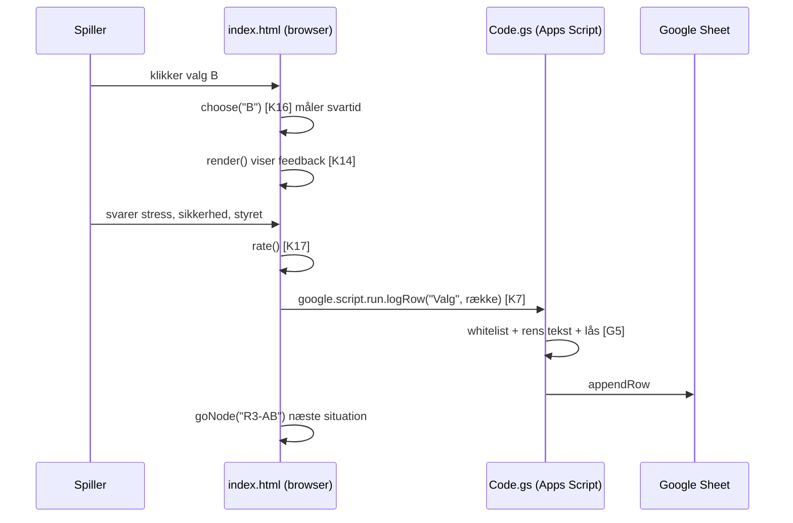

# Kodeguide

Opslag fra dokumentationen til koden. Hvert afsnit i koden starter med en kommentar som `/* [K14] ... */`.
Klik på referencen for at hoppe direkte til linjen på GitHub, eller søg efter fx `[K14]` i filen.

> Filen er genereret af `tools/lav-kodeguide.py`, så linjenumrene altid passer.

**Bogstaverne betyder:** S = stil (CSS) · H = HTML · K = klient-JavaScript · G = Google Apps Script (server) · R = resultatsiden

## src/index.html – spillet

| Ref | Del | Navne i koden | Hvad sker der |
|---|---|---|---|
| [S1](../src/index.html#L26) | **Design-tokens og tema** (linje 26) | `:root`, `--mon-*` | Alle farver ligger som CSS-variabler ét sted. Resten af CSS'en bruger kun variablerne, så tema og lys/mørk tilstand styres centralt. |
| [S2](../src/index.html#L56) | **Topbjælke** (linje 56) | `.top`, `.chip` | Titel og små "chips" med runde, klokkeslæt, forsøg og spiller. |
| [S3](../src/index.html#L66) | **Top 5-ticker** (linje 66) | `.ticker`, `.tk-track`, `@keyframes tk` | 30 px bjælke, der ruller fra højre mod venstre. Indholdet ligger to gange, og animationen flytter det -50 %, så rulningen ser uendelig ud. Stopper ved mus-over og ved "reduceret bevægelse". |
| [S4](../src/index.html#L83) | **Nedtælling** (linje 83) | `#timer`, `.on`, `.low` | Vandret bjælke, der skrumper på 15 sekunder og bliver rød til sidst. |
| [S5](../src/index.html#L90) | **De tre rammer** (linje 90) | `main#game`, `@media` | Grid med monitor, kort og tegneserie. Under 1100 px flyttes tegneserien ned, under 760 px stables alt (mobil). |
| [S6](../src/index.html#L120) | **Kortet** (linje 120) | `.card` | Info-, stress-, feedback-, game over- og slutkort. |
| [S7](../src/index.html#L135) | **Knapper** (linje 135) | `.actions`, `.key` | De fire valg og de store "videre"-knapper. |
| [S8](../src/index.html#L164) | **Patientnavne og spørgsmål** (linje 164) | `.pt`, `.opts`, `.side` | Farvede "piller" med stuenummer, knaprækker til forskningsspørgsmål og tegneserie-kolonnen. |
| [S9](../src/index.html#L192) | **Profilformular** (linje 192) | `.field` | Felterne i profilen før vagten. |
| [H1](../src/index.html#L228) | **Sidestruktur** (linje 228) | `#card`, `#actions`, `#ward`, `#side` | Tomme beholdere, som JavaScript fylder. Elementer findes med `$("id")`. |
| [H2](../src/index.html#L242) | **Ticker-HTML** (linje 242) | `#ticker`, `#tkTrack` | Fyldes af `renderTicker()` [K13]. |
| [H3](../src/index.html#L247) | **De tre rammer** (linje 247) | `#monitor`, `#card`, `#side` | Monitor [K10], kort [K14] og tegneserie [K12]. |
| [K1](../src/index.html#L278) | **Grundopsætning** (linje 278) | `SECONDS`, `PATIENTS`, `ROUNDS` | 15 sekunder pr. valg, de fire patienter og de fem runder. |
| [K2](../src/index.html#L289) | **Historietræet** (linje 289) | `N` | Spillets indhold: 31 noder. Node-ID'et er vejen hertil (`R3-AB`). Hver node har patienter `f`, `alarm`, `title`, `sit`, fire valg `c` (A, B, X1, X2) og feedback `fb`. Se [historier.md](historier.md). |
| [K3](../src/index.html#L397) | **Slutprofiler og slutninger** (linje 397) | `PROFILES`, `ENDINGS` | Profil efter antal A-valg (0-5) og 32 slutninger med hele vejen som nøgle, fx `AABBA`. |
| [K4](../src/index.html#L434) | **Tegneserie-manuskript** (linje 434) | `COMICS` | Tre paneler pr. node: `[venstre, højre, hvem taler, taleboble]`. |
| [K5](../src/index.html#L472) | **Farver, figurer, ur og svar** (linje 472) | `PCOL`, `PEOPLE`, `ANCHOR`, `DRIVERS`, `BLAME` | Patientfarver, figurer, ur-ankre i minutter efter midnat (420 = 07.00) og svarmuligheder. |
| [K6](../src/index.html#L480) | **Tilstand** (linje 480) | `player`, `profile`, `S` | Anonymt spiller-ID og profil i `localStorage`. `S` holder hele vagtens tilstand, bl.a. `S.phase`, `S.node`, `S.path`. |
| [K7](../src/index.html#L491) | **Datalaget** (linje 491) | `Data.save()`, `google.script.run` | Broen fra browser til server. Kalder `logRow()` [G5]. Fejl ignoreres bevidst, så spillet aldrig går i stå. |
| [K8](../src/index.html#L494) | **Top 5 og ventende række** (linje 494) | `loadHS()`, `flushPending()` | Henter top 5 fra `getHighscore()` [G7]. Et game over-valg gemmes først, når "hvem havde ansvaret?" er besvaret. |
| [K9](../src/index.html#L509) | **Ny spiller / nyt spil** (linje 509) | `newPlayer()`, `newGame()` | Nyt anonymt ID og tom profil, eller nyt vagt-ID. |
| [K10](../src/index.html#L519) | **Patientmonitoren** (linje 519) | `renderWard()`, `setVitals()`, `ecgTick()`, `beat()` | Fire stuer, puls og stress. EKG tegnes på `<canvas>` med `requestAnimationFrame`, hastigheden følger pulsen. |
| [K11](../src/index.html#L564) | **Hjælpefunktioner** (linje 564) | `esc()`, `hl()`, `clockNow()`, `opts()`, `bindOpts()` | `esc()` beskytter mod HTML i tekst. `hl()` gør patientnavne til farvede piller. `clockNow()` regner klokken ud (06.50 + 5 min pr. kort). |
| [K12](../src/index.html#L606) | **Tegneserien som SVG** (linje 606) | `person()`, `patientBed()`, `prop()`, `panel()`, `wrap()` | Figurer tegnes direkte som SVG. Ingen billedfiler. Talebobler ombrydes til højst 3 linjer. |
| [K13](../src/index.html#L656) | **Sidekolonne og ticker** (linje 656) | `renderSide()`, `renderTicker()` | Viser tegneserien for den aktuelle node og bygger top 5. |
| [K14](../src/index.html#L672) | **render() – tilstandsmaskinen** (linje 672) | `render()`, `goNode()` | Tegner skærmen ud fra `S.phase`: profile → start → info → stress → feedback/over → … → end. |
| [K15](../src/index.html#L837) | **Nedtællingen** (linje 837) | `startTimer()`, `stopTimer()` | Måler svartid i ms og hæver pulsen. Tiden ude = `choose("timeout")` = game over. |
| [K16](../src/index.html#L855) | **Et valg** (linje 855) | `row()`, `choose()` | Bygger én datarække. X1/X2/timeout = game over, A/B = feedback. |
| [K17](../src/index.html#L878) | **Bedømmelse og næste node** (linje 878) | `rate()` | Tjekker at de tre spørgsmål er besvaret, gemmer og går videre til `R{runde+1}-{vej}` eller slutskærmen. |
| [K18](../src/index.html#L893) | **Små hændelser og opstart** (linje 893) | `addEventListener`, `setInterval(loadHS)` | Mus over navn lyser stuen op, tasterne 1-4 vælger, klik på kaldenavn skifter profil. Første `render()` og top 5 hvert minut. |

## src/Code.gs – serveren

| Ref | Del | Navne i koden | Hvad sker der |
|---|---|---|---|
| [G1](../src/Code.gs#L14) | **Opsætning og datamodel** (linje 14) | `FOLDER_ID`, `SHEET_ID`, `KEY`, `COLS` | `COLS` er datamodellen: kolonnerne i hvert faneblad. Nye kolonner er sat bagerst, så gamle rækker passer. |
| [G2](../src/Code.gs#L26) | **doGet – web-appens dør** (linje 26) | `doGet(e)`, `out_()` | Viser spillet, eller resultatsiden hvis `?side=resultater&noegle=…` er rigtig. HTML læses fra Drive ved hvert besøg, så rettelser slår igennem uden ny udrulning. |
| [G3](../src/Code.gs#L46) | **Læs fil fra Drive** (linje 46) | `readFile_()` | Navne der ender på `_` er private og kan ikke kaldes fra browseren. |
| [G4](../src/Code.gs#L54) | **Faneblade** (linje 54) | `sheet_()` | Finder eller opretter fanebladet og retter overskriftsrækken til `COLS`. |
| [G5](../src/Code.gs#L69) | **Gem én række** (linje 69) | `logRow()` | Whitelist via `COLS`, tekst kortes til 300 tegn, `'` foran `= + - @` (formel-injektion), `LockService` mod samtidige skrivninger. |
| [G6](../src/Code.gs#L92) | **Læs data** (linje 92) | `rows_()`, `getData(key)` | Laver rækker om til objekter. Kun med den rigtige nøgle. |
| [G7](../src/Code.gs#L111) | **Top 5** (linje 111) | `getHighscore()` | Tæller korrekte valg, spil og hele vagter pr. spiller. Returnerer kun kaldenavn og tal. |
| [G8](../src/Code.gs#L130) | **Opsæt ark** (linje 130) | `opsaetArk()` | Køres manuelt fra editoren. |

## src/Resultater.html – resultatsiden

| Ref | Del | Navne i koden | Hvad sker der |
|---|---|---|---|
| [R1](../src/Resultater.html#L102) | **Konstanter og hjælpere** (linje 102) | `KEY`, `avg`, `f1`, `pct` | `%%KEY%%` og `%%GAME_URL%%` sættes ind af serveren [G2]. |
| [R2](../src/Resultater.html#L116) | **Hent data** (linje 116) | `load()` | Kalder `getData()` [G6] hvert 15. sekund. |
| [R3](../src/Resultater.html#L125) | **Saml pr. spiller** (linje 125) | `players()` | Kobler Spillere, Valg og Slutninger via spiller-ID og regner gennemsnit ud. |
| [R4](../src/Resultater.html#L150) | **Tegn siden** (linje 150) | `render()` | Hver blok fylder én sektion. |
| [R5](../src/Resultater.html#L160) | **System eller genvej pr. runde** (linje 160) |  | Andel A/B, svartid og stress pr. runde. |
| [R6](../src/Resultater.html#L169) | **Efter baggrund** (linje 169) |  | Sammenligning af grupper. |
| [R7](../src/Resultater.html#L176) | **Her døde flest + profiler** (linje 176) |  | Game over pr. node og fordeling af slutprofiler. |
| [R8](../src/Resultater.html#L184) | **Beslutningsoplevelse** (linje 184) | `DR` | Stress, sikkerhed, "hurtig og usikker" (under 5 sek. og sikkerhed 1-2) og hvad der styrede valget. |
| [R9](../src/Resultater.html#L198) | **Ansvar, job og refleksion** (linje 198) | `bars()` | Hvem fik skylden, job i plejen før/efter, sværeste dilemma, synsændring, fritekst. |
| [R10](../src/Resultater.html#L226) | **Tabel pr. spiller** (linje 226) | `cols` | Sortérbar tabel. Klik på række viser alle valg. |

## Sådan hænger det sammen: ét valg fra klik til regneark

## Typiske spørgsmål til eksamen, og hvor svaret står

| Spørgsmål | Kig her |
|---|---|
| Hvordan ved spillet, hvilken skærm der skal vises? | `S.phase` og `render()` [K6] [K14] |
| Hvordan er 32 slutninger bygget uden 32 filer? | Node-ID = vejen, `"R"+(runde+1)+"-"+S.path` i `rate()` [K2] [K17] |
| Hvordan kommer data fra telefonen til regnearket? | `Data.save` → `google.script.run` → `logRow` [K7] [G5] |
| Hvordan er spillerne anonyme? | Tilfældigt ID i `localStorage`, kun kaldenavn [K6] [K9] |
| Hvordan er data beskyttet? | Whitelist, 300 tegn, formel-injektion, `LockService`, nøgle til resultater [G5] [G2] [G6] |
| Hvorfor skal man ikke udrulle igen ved hver rettelse? | `readFile_()` læser HTML fra Drive ved hvert besøg [G2] [G3] |
| Hvordan bliver svartid og "hurtig og usikker" målt? | `S.t0` og `ms` i `choose()`, beregning i [R8] [K15] [K16] |
| Hvordan virker tickeren? | Indhold x2 + `translateX(-50%)` [S3] [K13] |
| Hvordan er tegneserien lavet? | SVG genereret i JavaScript fra `COMICS` [K4] [K12] |
| Hvordan hænger patientnavne og monitor sammen? | `hl()` og `mouseover` [K11] [K18] [K10] |
